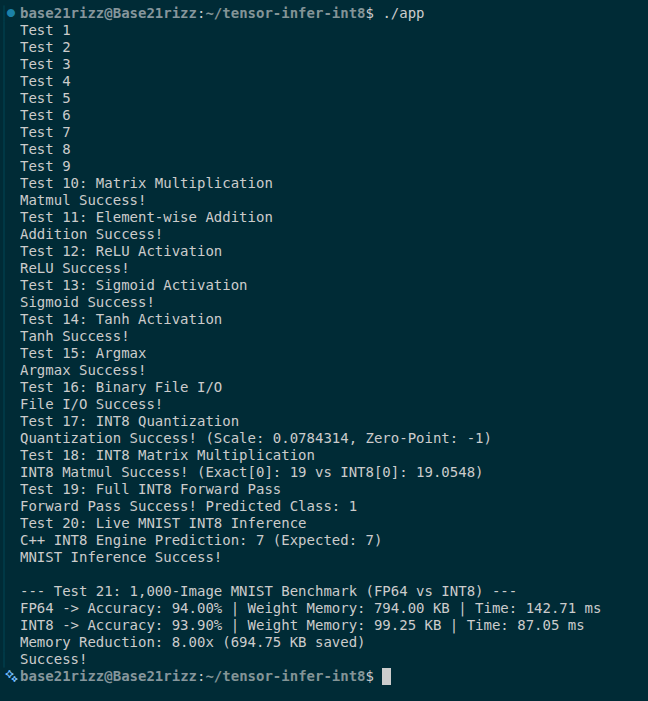

# tensor-infer-int8

A dependency-free C++23 neural network inference engine built from scratch to explore how 8-bit integer (`INT8`) quantization works under the hood.

Instead of relying on external math libraries like Eigen or BLAS, all tensor memory management, matrix operations, activation functions, binary serialization, and quantization routines are written in standard C++. Python (PyTorch) is only used offline to train a baseline MNIST model and dump the raw weights as `.bin` files.

## 1,000-Image MNIST Benchmark (`-O3`)

Architecture: `784 -> 128 (ReLU) -> 10`, which is 101,632 weights plus 138 biases. Evaluated on 1,000 unseen MNIST test images. The baseline is FP64 (`double`).

| Precision | Accuracy | Weight Memory |
| :--- | :--- | :--- |
| **FP64 (`double`)** | 94.00% | 794.00 KB |
| **INT8 (`int8_t`)** | 93.90% | 99.25 KB |

* **Memory footprint:** 8.00x smaller than FP64 (694.75 KB saved). The figure counts the 101,632 weights only, not the 138 biases.
* **Accuracy drop:** 0.10 percentage points, which is 1 image out of 1,000. At this sample size that is within noise, so the INT8 model is not claimed to be lossless.

### Timing

Total time for the 1,000 images, including dynamic on-the-fly quantization of the input and hidden layer. Timings change from run to run on my machine, so two separate runs are shown:

| Precision | Run 1 | Run 2 |
| :--- | :--- | :--- |
| **FP64 (`double`)** | 155.82 ms (0.156 ms / image) | 142.71 ms (0.143 ms / image) |
| **INT8 (`int8_t`)** | 123.30 ms (0.123 ms / image) | 87.05 ms (0.087 ms / image) |
| **INT8 faster by** | 20.9% | 39.0% |

INT8 was faster than FP64 in both runs, but the size of the speedup is not stable. Single runs should not be treated as a precise figure.

## How It Was Built (Step-by-Step)

The project was built incrementally over a week, validated by 21 unit and integration tests in `main.cpp`:

1. **Tensor Foundation (Nov 8):** Built the core `Tensor` class backed by a single contiguous `std::vector<double>` for cache locality, computing multi-dimensional indices manually via shapes and strides.
2. **Matrix Multiplication & Bias Broadcasting (Nov 9):** Implemented 2D `matmul` and element-wise `add` with a direct broadcasting workaround to add `1xN` bias vectors across `MxN` layer outputs without allocating duplicate rows.
3. **Activations, Argmax & Raw Binary I/O (Nov 13):** Added `relu`, `sigmoid`, and `tanh` activations, `argmax` to pull the winning class index from output logits, and `load_tensor` / `save_tensor` to read raw IEEE-754 bytes directly into memory without text-parsing overhead.
4. **Linear INT8 Quantization (Nov 15):** Implemented asymmetric quantization mapping `double` distributions into `int8_t` (`[-128, 127]`) by computing a floating-point `scale` and an integer `zero_point`:
   $$q = \text{clamp}\left(\text{round}\left(\frac{x}{\text{scale}}\right) + \text{zero-point}, -128, 127\right)$$
5. **INT8 Matmul with 32-Bit Accumulation (Nov 15):** Multiplying two `int8_t` values immediately overflows an 8-bit register. `matmul_int8` subtracts the zero-points, accumulates products inside a 32-bit integer (`int32_t`), and rescales the final dot product back to `double` using `A.scale * B.scale` so bias addition and ReLU work seamlessly.
6. **End-to-End Forward Pass & Benchmarking (Nov 15):** Chained the operations into `forward_pass`, wrote `export_mnist.py` to train and transpose PyTorch weights (`[out, in]` $\rightarrow$ `[in, out]`), verified live digit prediction (Test 20), and benchmarked 1,000 images against an unquantized FP64 baseline (Test 21).

## Quick Start

### 1. Export MNIST Weights & Test Batch

```bash
python3 -m venv .venv
source .venv/bin/activate
pip install torch torchvision numpy --index-url https://download.pytorch.org/whl/cpu
python3 export_mnist.py
```

### 2. Compile & Run Benchmark

```bash
g++ -std=c++23 -O3 main.cpp -o app
./app
```
